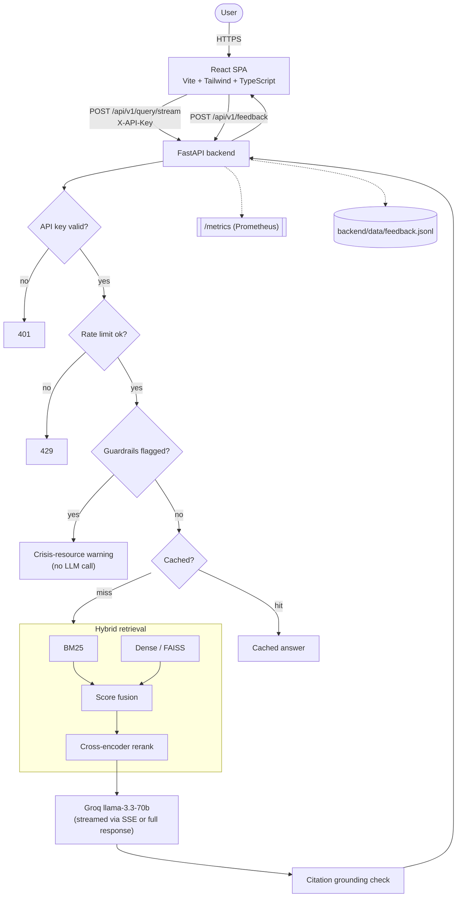

# HealthLens

HealthLens is a full-stack medical Q&A app that answers questions grounded in PubMed
literature. It runs hybrid retrieval (BM25 + dense embeddings, fused and reranked by
a cross-encoder) against a local 200k-abstract corpus, optionally decomposes complex
questions into sub-queries, and generates cited answers via Groq (Llama 3.3 70B) —
streamed token-by-token or returned as a single response. Every answer is checked
for citations that point at sources that were never retrieved.

> **Not medical advice.** Educational and research use only. Always consult a
> qualified healthcare professional. See [Disclaimer](#disclaimer).

## Features

- **Hybrid retrieval** — BM25 + dense (FAISS) fusion over whole abstracts, using
  either a weighted blend or reciprocal rank fusion (`FUSION_METHOD`), then reranked
  by a cross-encoder (`cross-encoder/ms-marco-MiniLM-L-6-v2`)
- **Citation grounding check** — every answer is scanned for citations to sources
  that do not exist and for factual sentences with no citation; the result is
  returned as a `grounding` report, shown in the UI, and counted in Prometheus
- **Clickable citations and source cards** — `[1]` markers in the answer jump to the
  matching paper, which shows an abstract snippet and a PubMed link
- **Local history** — past questions and answers are kept in the browser's
  `localStorage` only; crisis-flagged questions are never saved
- **Query decomposition** — complex multi-part questions are split into sub-queries
  via Groq before retrieval, then merged
- **Streaming answers** — `/api/v1/query/stream` sends the Groq response
  token-by-token over SSE; `/api/v1/query` returns the full answer in one response
- **Query caching** — 500-entry, 1-hour TTL in-memory cache keyed on the normalized
  question + decompose flag, shared by `/query` and `/query/stream` (a cached stream
  replays the answer as a single token event)
- **Feedback loop** — every answer carries a `query_id`; thumbs up/down posts to
  `/api/v1/feedback` and appends to `backend/data/feedback.jsonl`
- **Guardrails** — regex-based self-harm/crisis detection short-circuits before the
  LLM is ever called, returning crisis resources instead
- **API key auth + rate limiting** — `X-API-Key` required on cost-bearing endpoints;
  per-IP rate limit via `slowapi`
- **Observability** — structured JSON logs with per-request correlation IDs,
  `/health/live` + `/health/ready` probes, `/metrics` (Prometheus)

## Architecture



## Eval results

Evaluated on **50 medical questions** against the full **200,000-abstract** corpus
(Recall@5, MRR, Precision@5, top-5 retrieval):

| Mode | Recall@5 | MRR | Precision@5 |
|---|---|---|---|
| BM25-only | 0.060 | 0.121 | 0.060 |
| Dense-only (measured with the bug below) | 0.000 | 0.000 | 0.000 |
| Hybrid (measured with the bug below) | 0.092 | 0.190 | 0.092 |
| Hybrid + cross-encoder rerank (measured with the bug below) | 0.120 | 0.266 | 0.120 |

**Only the BM25 row is trustworthy.** The other three were measured before the dense
retrieval bug described in the next section was fixed, so they need to be re-run:

```bash
cd backend && python eval/eval_harness.py            # all modes
python eval/eval_harness.py --modes dense hybrid hybrid_rrf hybrid_rerank hybrid_rrf_rerank
```

The harness also compares weighted fusion against reciprocal rank fusion
(`hybrid_rrf*` modes). `python eval/answer_eval.py --limit 10 [--judge]` measures
answer quality instead of retrieval: how often citations are valid and how many
factual sentences are cited, plus an optional LLM judge for claim support.

## Design decisions: the dense retrieval bug

Dense-only retrieval originally scored exactly **0.000** and returned the same few
PMIDs for every question. That was first diagnosed as embedding hubness. It was
actually an indexing bug: FAISS `search` returns scores sorted best first, together
with a separate array of document ids. The code kept only the sorted scores and used
them as if element *i* belonged to document *i*, so the "ranking" was simply the first
documents in the corpus file, whatever the query said.

`backend/tests/test_retrieval.py` reproduces it with a small stub encoder. On the old
code every query returns the same documents; on the fixed code each query returns the
document that matches it.

What this changes:

- Hybrid fusion was blending real BM25 scores with a meaningless dense vector, so the
  old hybrid and hybrid + rerank numbers were measured under that noise.
- The earlier experiments (L2 index, query expansion, hub-frequency suppression,
  mean-centering, the `pubmedbert-base-embeddings` swap, sentence-level chunking) were
  all run on top of the bug. Their conclusions should be treated as unproven and
  repeated now that dense retrieval works. Sentence-level chunking is not in the
  current code; the index holds one vector per abstract.
- The cross-encoder rerank stage is still a sound final step. How much it adds on top
  of a working dense leg is what the re-run will show.
- Cached embeddings are unaffected: the bug was in scoring, not in how documents were
  embedded, so `data/index_cache/` does not need to be rebuilt.

**Next, once the eval is re-run:** compare weighted vs. RRF fusion, then try a
stronger embedding model through `EMBEDDING_MODEL_ID` (with `EMBEDDING_QUERY_PREFIX` /
`EMBEDDING_DOC_PREFIX` for models such as e5 or bge) and compare on the same harness.

## Project structure

```
healthlens/
├── backend/
│   ├── main.py                 # FastAPI app: routes, auth, rate limiting, SSE
│   ├── config.py                # pydantic-settings, single source of env config
│   ├── retrieval.py             # BM25 + dense + FAISS, score fusion, cross-encoder rerank
│   ├── grounding.py             # citation checks and abstract snippets
│   ├── query_decomposition.py   # LLM-driven sub-query splitting + merge
│   ├── llm.py                    # Groq calls (streaming + non-streaming)
│   ├── cache.py                  # TTL/LRU query cache
│   ├── feedback.py               # thumbs up/down JSONL log
│   ├── metrics.py                # Prometheus metric definitions
│   ├── guardrails.py             # self-harm/crisis regex detection
│   ├── logging_config.py         # structured JSON logging + request IDs
│   ├── ingest.py                 # live PubMed fetch fallback (no local corpus)
│   ├── index_pubmed.py           # one-time bulk corpus indexer
│   ├── eval/
│   │   ├── eval_harness.py      # retrieval metrics per mode
│   │   ├── answer_eval.py       # answer grounding + optional LLM judge
│   │   ├── benchmark.json        # 50 questions with ground-truth PMIDs
│   │   └── results.json
│   ├── tests/                    # pytest suite
│   ├── data/
│   │   ├── pubmed_abstracts.jsonl  # gitignored, ~200k abstracts
│   │   ├── index_cache/            # gitignored, cached embeddings/FAISS index
│   │   └── feedback.jsonl          # gitignored, runtime-generated
│   ├── Dockerfile
│   ├── requirements.txt
│   └── requirements-dev.txt
├── frontend/
│   ├── src/
│   │   ├── App.tsx                # main UI and state
│   │   ├── api.ts                 # SSE streaming client, feedback call
│   │   ├── history.ts             # localStorage history
│   │   ├── components/            # AnswerText, SourceCard, HistoryDrawer, Decor
│   │   ├── ErrorBoundary.tsx
│   │   └── main.tsx
│   ├── Dockerfile
│   └── nginx.conf
├── docker-compose.yml
├── render.yaml                    # Render Blueprint (API + web app)
├── .github/workflows/ci.yml
└── README.md
```

## Setup

### Prerequisites

- Python 3.12+
- Node.js 22+
- A [Groq API key](https://console.groq.com/)
- Optional: [NCBI API key](https://www.ncbi.nlm.nih.gov/account/) for bulk indexing

### Local development

```bash
cd backend
python -m venv venv
source venv/bin/activate   # Windows: venv\Scripts\activate
pip install -r requirements-dev.txt   # includes pytest, ruff

cp .env.example .env
# edit .env: set GROQ_API_KEY and HEALTHLENS_API_KEY
# generate a key: python -c "import secrets; print(secrets.token_urlsafe(32))"

uvicorn main:app --reload --port 8000
```

The first request that needs retrieval builds the corpus index (BM25 + dense
embeddings over sentence chunks) and caches it to `data/index_cache/` — this is the
slow step (minutes, scales with corpus size and machine). Subsequent starts load
from cache. If `data/pubmed_abstracts.jsonl` is missing, `/query` falls back to a
live per-request PubMed fetch instead.

```bash
cd frontend
npm install
cp .env.example .env   # set VITE_HEALTHLENS_API_KEY to match the backend
npm run dev
```

Open [http://localhost:5173](http://localhost:5173).

Run tests and lint:

```bash
cd backend && pytest -v && ruff check .
cd frontend && npm run lint && npm test && npm run build   # build runs tsc --noEmit first
```

### Docker

```bash
# in repo root, with GROQ_API_KEY / HEALTHLENS_API_KEY set in your shell or a .env file
docker compose up --build
```

This builds both services (multi-stage Dockerfiles, non-root users, baked-in model
weights for offline startup) and mounts `backend/data` read-only into the backend
container. Frontend serves on `:5173` (nginx), backend on `:8000`.

## Environment variables

**Backend** (`backend/.env`, see `backend/.env.example`):

| Variable | Default | Purpose |
|---|---|---|
| `GROQ_API_KEY` | — | Required. Groq API key for answer generation |
| `HEALTHLENS_API_KEY` | — | Required. Clients must send this as `X-API-Key` |
| `NCBI_API_KEY` | — | Optional. Raises NCBI E-utilities rate limits for `index_pubmed.py` and the live PubMed fallback |
| `ENVIRONMENT` | `development` | `production` enables stricter behavior via `settings.is_production` |
| `CORS_ORIGINS` | `http://localhost:5173` | Comma-separated allowed frontend origins |
| `RATE_LIMIT_PER_MINUTE` | `20` | Per-IP limit on `/query` and `/query/stream` |
| `LOG_LEVEL` | `INFO` | Structured logger level |
| `EMBEDDING_MODEL_ID` | `sentence-transformers/all-MiniLM-L6-v2` | Dense embedding model. A new model or document prefix gets its own cache entry automatically |
| `EMBEDDING_QUERY_PREFIX` / `EMBEDDING_DOC_PREFIX` | empty | Instruction prefixes for models that need them (e5: `query: ` / `passage: `) |
| `RERANKER_MODEL_ID` | `cross-encoder/ms-marco-MiniLM-L-6-v2` | Cross-encoder reranker model |
| `FUSION_METHOD` | `weighted` | `weighted` (min-max blend) or `rrf` (reciprocal rank fusion) |
| `DENSE_WEIGHT` | `0.5` | Dense share of the weighted blend |
| `RERANK_POOL_SIZE` | `25` | Candidates passed from fusion to the cross-encoder |

**Frontend** (`frontend/.env`, see `frontend/.env.example`):

| Variable | Default | Purpose |
|---|---|---|
| `VITE_API_URL` | `http://localhost:8000` | Backend base URL |
| `VITE_HEALTHLENS_API_KEY` | — | Baked into the built JS bundle — see the caveat in `.env.example` and `App.tsx` about this not being a real secret in a public SPA |

## API reference

All `/api/v1/*` endpoints require header `X-API-Key: <HEALTHLENS_API_KEY>` and are
rate-limited per IP. `/health/*` and `/metrics` are unauthenticated.

### `POST /api/v1/query`

```json
{ "question": "What are the latest treatments for type 2 diabetes?", "decompose": false }
```

```json
{
  "query_id": "b7e2...",
  "answer": "...",
  "sources": [{ "title": "...", "pmid": "12345678", "snippet": "First sentences of the abstract..." }],
  "grounding": {
    "cited": [1, 2], "invalid": [], "claim_sentences": 4,
    "cited_sentences": 4, "coverage": 1.0, "grounded": true
  },
  "flagged": false,
  "warning": null
}
```

### `POST /api/v1/query/stream`

Same request body. Response is `text/event-stream`, hand-rolled SSE (not native
`EventSource` — see `App.tsx` for why: POST bodies and custom headers aren't
supported by the browser `EventSource` API). Events, in order:

```
event: sources
data: {"sources": [...], "query_id": "b7e2..."}

event: token
data: {"text": "The"}

event: token
data: {"text": " latest"}

...

event: grounding
data: {"cited": [1, 2], "invalid": [], "coverage": 1.0, "grounded": true, ...}

event: done
data: {}
```

`grounding` has the same shape as in the non-streaming response. `invalid` lists
citation numbers that do not match any retrieved source; `coverage` is the share of
factual sentences that carry a citation. It checks the answer's structure, not whether
each claim is actually true, so the sources still need to be read.

A flagged (guardrail-blocked) question sends `event: flagged` with `{"warning": "..."}`
instead of `sources`/`token`/`done`. Failures send `event: error` with `{"detail": "..."}`.

### `POST /api/v1/feedback`

```json
{ "query_id": "b7e2...", "rating": "up", "answer_preview": "The latest treatments..." }
```

Appends to `backend/data/feedback.jsonl`. `rating` must be `"up"` or `"down"`.

### `GET /health/live` / `GET /health/ready`

Liveness (process is up) vs. readiness (corpus index warm + LLM key configured — a
missing local corpus is *not* a readiness failure, since `/query` transparently falls
back to live PubMed fetch). Readiness returns `503` when not ready.

### `GET /metrics`

Prometheus exposition format: `request_latency_seconds`, `requests_total`,
`cache_hits_total`, `groq_tokens_used_total`, `answers_total` (labelled by `grounded`),
`retrieval_recall_proxy`.

## Deploy

`render.yaml` is a [Render Blueprint](https://render.com/docs/blueprint-spec) with two
services: `healthlens-api` (the Docker backend) and `healthlens-web` (the static
frontend).

1. Push the repo to GitHub.
2. In Render, choose **New > Blueprint** and select the repo.
3. Fill in the prompted values:
   - `GROQ_API_KEY`: your Groq key.
   - `HEALTHLENS_API_KEY` and `VITE_HEALTHLENS_API_KEY`: the same value in both places.
   - `CORS_ORIGINS`: the web app's URL.
   - `VITE_API_URL`: the API's URL.
4. If a URL was not known when you created the Blueprint, set it afterwards in the
   service's environment settings and redeploy. `VITE_*` values are baked in at build
   time, so the web app must be rebuilt after changing them.

Notes:

- The backend loads two models and needs a 2 GB plan (`1c-2g`); a 512 MB plan will not fit.
- The 200k-abstract corpus is gitignored, so a deployed backend runs in live-PubMed
  fallback mode (a PubMed fetch per question; if the question finds nothing, it is
  retried with just its content words). Setting `NCBI_API_KEY` raises PubMed's rate limit. Serving the full corpus needs the data
  and index cache on a persistent disk.
- `/metrics` has no auth. Restrict it at the network layer if the service is public.
- The Docker image listens on `$PORT` (default `8000`).

## CI/CD

`.github/workflows/ci.yml` runs on every push/PR: backend lint (`ruff`) + test
(`pytest`) + Docker build, frontend lint (`eslint`) + tests (`vitest`) + typecheck+build (`tsc` + `vite
build`) + Docker build.

## Disclaimer

HealthLens is for educational and research purposes only. It does not provide
medical advice, diagnosis, or treatment. Always consult a qualified healthcare
professional. Unsafe queries (e.g. self-harm) are blocked before reaching the LLM and
show crisis resources (911, 988) instead.
